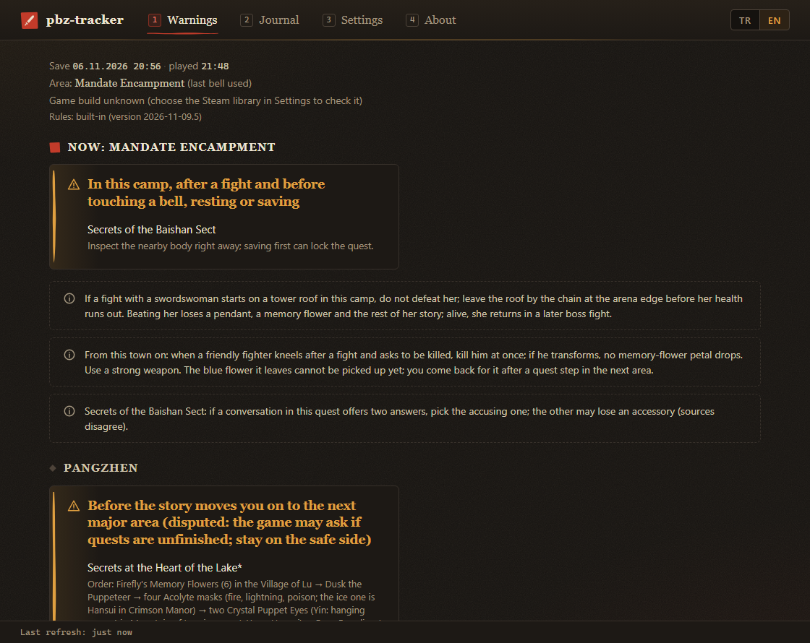
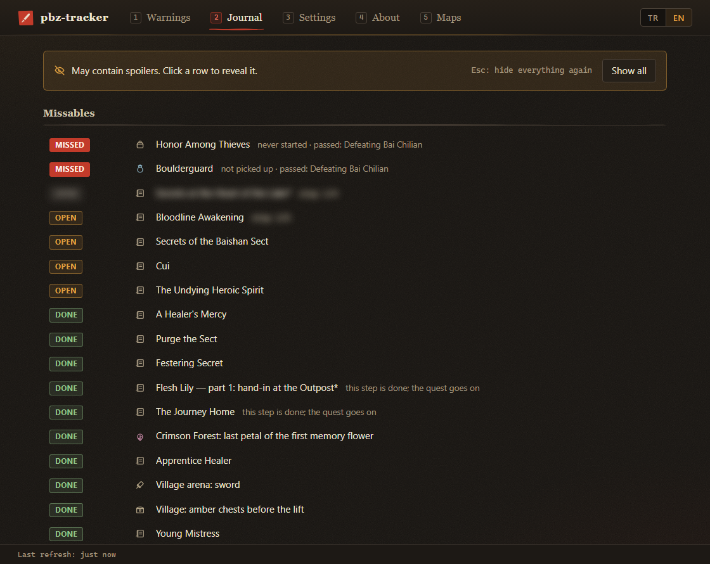

# pbz-tracker

**▶ Open it: https://zziroo.github.io/pbz-tracker/**

A **read-only**, spoiler-safe missables tracker for **Phantom Blade Zero** (PC, Steam) that runs in your browser. It reads your save and warns you only when you are about to lose something for good. Everything else stays hidden until you ask for it.

*Türkçe: [README.tr.md](README.tr.md)*

## What it does / does not do

- Reads your save, finds missable quests that are still open, and tells you which point you must not pass yet: "Before this area's final fight", not a boss name.
- **Never writes** to your save, its backups, the game folder or any patch. The browser only gets read access. What the page remembers (the derived key, the chosen folders, the settings and the quest timeline) stays in that browser's storage for the site (IndexedDB). The game can stay open while it reads the save.
- **Runs entirely in your browser.** No file is uploaded and no request leaves the page; you can check this in DevTools → Network. No telemetry, no update check. It is a static page with no server side: the site only serves its own files. After the first visit it also works offline. Links in the About tab open only when you click them.
- **Contains no key and no personal data.** The save key is derived in your browser from *your own* `PBZ.exe` (read in chunks, never as a whole). The page contains no SteamID, save data or key.
- Does not attach to the game process and does not read its memory.

## Install

Nothing to download: open **https://zziroo.github.io/pbz-tracker/**.

- **Chrome or Edge on the desktop** (File System Access API): click **Choose game folder** and pick the game folder (`…\steamapps\common\PBZ`) or your Steam library folder (`…\SteamLibrary`; the library also gives the game build for the header). The browser asks for read access. You can also drag the folder onto the page. On the next visit one click, **Continue with PBZ**, is enough (the browser asks again for read access once per visit unless you let it remember).
- **Install it as an app** to keep it in its own window next to the game: browser menu → Install (or the install icon in the address bar; in Edge: Apps → Install this site as an app).
- **Firefox, Safari, or if Chrome refuses the folder** (it blocks some system folders, such as a Steam library under `C:\Program Files (x86)`): switch Settings → File access to **Single files**, then choose or drop `PBZSaveGame.sav` and, once, `PBZ.exe` (the key is then remembered). Optionally choose the `Paks` folder for names from a text patch (the browser may call this an "upload"; nothing leaves the page). In this mode the page cannot refresh by itself: after the game saves, choose or drop the save again.
- Phones and tablets are not supported.

**Privacy.** The key is remembered in this browser's storage for the site (IndexedDB), looked up by the size and date of `PBZ.exe`, so a game update triggers a new derivation. The chosen folders, the settings and the quest timeline are stored there too, and only there. **Forget** in Settings removes a chosen folder or file (and, for PBZ.exe, the key); clearing the site data in the browser removes everything. Note: on GitHub Pages every project of the same user shares one origin (`<user>.github.io`), so that browser storage is visible to the publisher's other Pages projects; a dedicated custom domain avoids this. Nothing is written to disk outside the browser's own storage, and nothing is ever written to the game, the save or its backups.

## Usage

Leave the page open next to the game. It checks the save every 3 seconds (Settings: 2–3600 s) and refreshes whenever the game saves. In a background tab the browser may slow these checks down to about once a minute; switching back to the tab refreshes at once.



- **Warnings** (default tab): only what you are about to lose, or "No risk of missing anything right now."
- **Journal**: status of the quests in your journal, step counters, missed items and the purple-quest tally. Rows are blurred until you click them (quests already in your journal keep their name and status readable); any refresh blurs them again.
- **Settings**: language (TR/EN), name source, refresh interval, file access, and the game folder / save file (choose or forget).
- **About**: version, tested game build, license, guide links.



- Several Steam accounts: choose the account in Settings. A save stored elsewhere (for example under `%LOCALAPPDATA%\ProjectPBZ\Saved\SaveGames`): choose the save file in Settings.
- Not installed through Steam? Choose the game folder itself. Without a Steam manifest the game build is shown as unknown, without an "untested" warning.

## Spoiler policy

1. **Default view:** only actionable warnings, meaning a cutoff ahead of you with something still open. Cutoffs are described by position, never by name. A quest is named only if it already appears in your journal; otherwise you get a location hint. With nothing at risk you see: "No risk of missing anything right now."
2. **Hidden (Journal tab):** journal status, step counters, missed items, purple-quest tally. Quests already in your journal show their name and status; step counters, notes and anything you haven't met yet stay blurred until you click a row. Section titles with their counts stay visible. Everything is blurred again on every refresh.
3. **Never shown:** anything your save says you have not reached. The line is always drawn from the save of the person running the tool.

**Exact names (opt-in, off by default):** Settings → "Show place and boss names in warnings" writes the cutoff with its place and boss names, but only for areas your save shows you have reached; every other cutoff keeps its positional wording.

### Diagnostics and the quest timeline

At the bottom of Settings, **Diagnostics** (collapsed) lists quests in your save that the name table does not know (their count is shown on the panel header), undetectable rules in range for this save, the rules and name-table versions, the text patch found, the game build and the tool version. **Copy report** copies the same as plain text for a GitHub issue; it contains no paths, Steam account ids or user names, and of the save time only the date.

The tool also keeps a local **quest timeline**: on every read, quests that appeared or changed state are appended (save time, quest id, folder, old and new state, changed branches, step counter, level code), at most 2000 records. A quest that is no longer in the save gets one record with no new state. It is meant for checking the rules after a playthrough; an export contains your play times (save timestamps). It is stored in the browser's storage for the site (IndexedDB). **Export timeline** / **Copy timeline** in Diagnostics give it as JSON. Turn it off there (this only stops recording); **Delete timeline** removes it, and so does forgetting everything. It never goes anywhere by itself.

## Supported game build

Verified on Steam build **26367565**. The header shows the installed build. On an untested build it shows a one-line warning. If the game update changed the save key, the tool stops with a clear error that names the build.

## Rule updates

The rules (`data/rules.json`) and name tables are built into the page. Rule fixes ship by republishing the web version: when the rules change, the site is rebuilt, and the next visit picks up the new rules. The header shows the rules version. The tool itself never downloads anything else.

## Names and languages

- UI language and name source are independent. Default: English UI with the official English names. When the browser language is Turkish and the chosen folder has the Turkish fan patch, the page starts in Turkish and reads Turkish names from the patch. The language chosen in Settings always wins.
- A text patch in `ProjectPBZ\Content\Paks` (an unencrypted `.pak` carrying `Localization/Game/<culture>/Game.locres`, for example a fan translation) is detected in the chosen folder and used for names at runtime, read-only. Supported: paks with a legacy index (v1–v9), or small (≤ 32 MB) uncompressed paks of any version. The official game paks (v12) are skipped.
- Without a patch, names come from `data/names.<lang>.json`. English is complete; missing names fall back to English with a one-line notice.
- To contribute a name table, see the Turkish README section "Ad tablosuna katkı". In short: copy `data/names.en.json` to `names.<lang>.json`, translate the values, and add one line to `EMBEDDED_TABLES` in `lib/core/names.js`.

## For developers

Node 18+ with no dependencies.

### Terminal (`node pbz.js --cli`)

A terminal tool for development and analysis: the same engine as the page, reading the save **read-only**. It prints the same report as the Warnings and Journal tabs. The terminal is its only mode, so `--cli` may be left out.

```
node pbz.js --cli                  # read once and print
node pbz.js --cli --watch          # refresh whenever the game saves (G = toggle hidden sections, Q = quit)
node pbz.js --cli --interval 5     # poll interval in watch mode, seconds (2–3600)
node pbz.js --cli --show           # also print the hidden sections
node pbz.js --cli --exact          # name places and bosses in the warnings (only in areas you have reached)
node pbz.js --cli --dump [folder]  # write the newest save slot as JSON (default .\out; debugging)
node pbz.js --cli --lang en        # UI language: en or tr
node pbz.js --cli --names en       # name source: a detected text patch (e.g. ProjectPBZ-Windows_C) or a table language
node pbz.js --cli --rules <path>   # use another rules file instead of data/rules.json
node pbz.js --cli --save <path>    # save file; --game <PBZ folder>, --exe <PBZ.exe> likewise
node pbz.js --cli --steamid <id>   # which Steam account, if there are several
node pbz.js --cli --forget         # delete pbz-tracker.config.json (remembered game/save path)
node pbz.js --cli --no-color       # no colours
node pbz.js --help
node pbz.js --version
```

`--dump` writes a full, decrypted dump of your save (`out\latest.json`). It may contain personal data such as your play history; do not share it. It refuses to write into the game or save folder.

The game is found through Steam (registry `SteamPath` → `libraryfolders.vdf` → AppID 4115450), then in common folders (`<drive>:\SteamLibrary`, `Program Files\Steam`, `<drive>:\Games\PBZ`). If several Steam accounts have saves, pass `--steamid`. An optional `pbz-tracker.config.json` next to `pbz.js` (`{ "gameDir": …, "savePath": … }`, written by hand) is used before that detection; `--forget` deletes it. A `rules.json` or `names.<lang>.json` next to `pbz.js` overrides the one in `data/`. A broken rules file, or one written for a different rules format (`schemaVersion`), stops the tool with an error instead of silently using the built-in copy. Apart from `--forget` and the optional `--dump` output, the CLI writes nothing.

### Web build

`node build/build.js` writes the static site to `web/dist/` (`index.html`, the unchanged `ui/app.js` and `ui/style.css`, `web.js` = the engine plus `web/*.js` bundled for the browser, `sw.js`, `manifest.webmanifest`, `icon.svg`). The page talks to `web/transport.js` (contract: `docs/ui-api.md`). The build fails if a Node built-in ends up in the browser bundle. `.github/workflows/pages.yml` builds and publishes it on GitHub Pages on every push to `main` (see `docs/publish.md`). To try it locally, serve `web/dist/` over `http://localhost` (any static server); a page opened as a `file://` URL cannot use folder access or the service worker.

### Tests

- `node test/core-portability.js`: proves the engine core is browser-safe (no Node built-ins, runs in a browser-style sandbox).
- `node test/core-e2e.js [--game <PBZ folder>] [--save <PBZSaveGame.sav>]`: runs the portable core against a real game folder and save, and checks its report equals `node pbz.js --cli --no-color`. Read-only.
- `node test/oodle-compare.js --game <PBZ folder> --dll <dll>`: compares the save decompressor against the Oodle DLL (needs a copy of `oo2core_8_win64.dll` from another game).

`data/rules.json` contains spoilers for the whole game.

### Rule syntax (`data/rules.json`)

- `schemaVersion`: file format (the tool refuses a mismatch). `rulesVersion`: version of the rule content; bump it on every fix, it is shown in the header.
- `sources`: guide registry. Each rule has `source: {ids, checked}`; `checked: "unverified"` means the rule-to-guide mapping was not checked page by page.
- `cutoffs`: points of no return. `where` {tr,en} describes the point by position (default view); `label` names it (hidden section only, after the point is passed); `passedWhen` is the condition for "passed". Optional `whereExact` {tr,en} is the same sentence with place and boss names, used instead of `where` only when exact names are on **and** the optional condition `exactWhen` is true (the player has reached that area); `exactWhen` missing, false or unknown keeps `where`.
- `missables`: `quest` (pinyin id from the save, or `null`), `cutoff`, `visibleWhen`, optional `doneWhen` / `failedWhen`, `hintNotStarted` {tr,en}, `warn` {tr,en}, `detect: false` (cannot be read from the save). `type: "info"` rules are plain warnings: `warn` is the anonymous text (default view), `warnNamed` the named one (hidden section), `activeWhen` keeps them in the default view.
- `trueEnding`: explicit list of true-ending purple quests; entries without a known pinyin id are never shown.

Conditions are three-valued (true / false / unknown): `mapUnlocked`, `levelVisited`, `currentLevel`, `bellPrefix`, `bossKilled`, `bossSeen`, `questSeen`, `questDone`, `questBranch` + `branch` (+ `state`), `any`, `all`, `not`, `unknown`.

## Known limits

- Some later cutoffs cannot be detected from the save yet; their warnings rely on quest state and positional wording.
- Guides disagree on one story cutoff: some say entering a later story area closes certain lake-side quests, while players on the Steam forum report that the real point of no return comes near the end, with an explicit in-game warning. The tool keeps the stricter rule, marked as a guess, until it can be checked from a save.
- Some guides also list two optional boss fights as true-ending requirements. They are not tracked yet (unverified).
- A few quest-name mappings are inferred and marked `*`; one warning's wording (the camp warning) is unverified.

## License

GPL-3.0-or-later (see `LICENSE`). The save decompressor in `lib/core/oodle/` is a JavaScript port of Powzix's [ooz](https://github.com/powzix/ooz) (GPL-3.0-or-later). If you redistribute the tool, make the source (this repository) available too.

## Sources and thanks

Missable rules were compiled from public guides. Each rule's `source` in `data/rules.json` says which ones it came from and how the mapping was checked.

- Game8 — missables: https://game8.co/games/Phantom-Blade-Zero/archives/634952
- PowerPyx — trophy guide & roadmap: https://powerpyx.com/phantom-blade-zero-trophy-guide-roadmap
- DTGRE (https://www.dtgre.com) — missable quests and true ending guides. Exact page URLs are only in `data/rules.json`, because the addresses themselves contain spoilers.
- Steam Community — Phantom Blade Zero guides: https://steamcommunity.com/app/4115450/guides/ and the forum thread on the point of no return: https://steamcommunity.com/app/4115450/discussions/0/572679490124259489/
- Maxroll (true ending), allthings.how (missables), Showgamer (missables): URLs to be added.

Technical:

- [ooz](https://github.com/powzix/ooz) by Powzix (Oodle decompression).
- Save format write-ups: phantombladezerosaves.com/save-file-format and a dev.to article (URL to be added).

Not affiliated with S-GAME. Phantom Blade Zero is a trademark of its owners.
