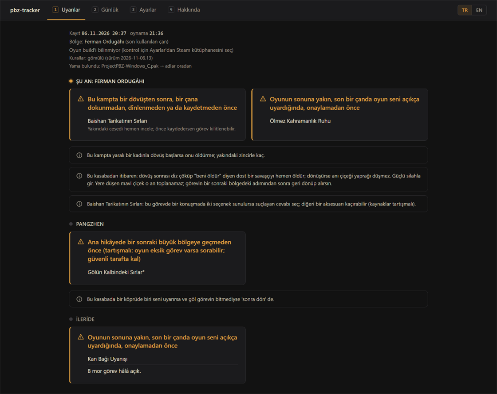
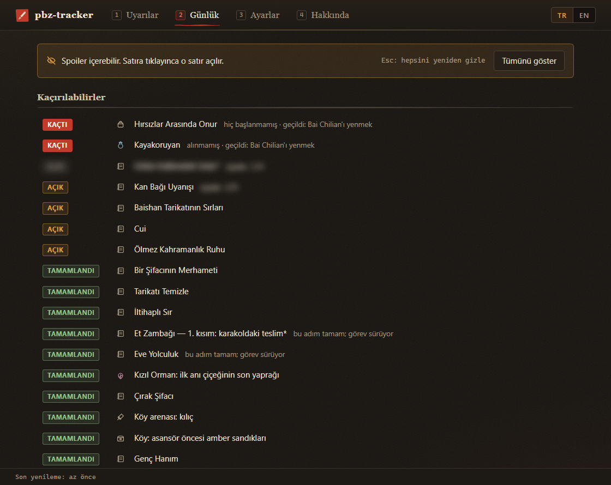

# pbz-tracker

**▶ Aç: https://zziroo.github.io/pbz-tracker/**

**Phantom Blade Zero** (PC, Steam) için tarayıcında çalışan, **salt okunur**, spoilersız kaçırılabilir takipçisi. Save'ini okur ve yalnız bir şeyi kalıcı olarak kaçırmak üzereysen uyarır. Geri kalanı, sen isteyene kadar gizli kalır.

*English: [README.md](README.md)*

## Ne yapar / ne yapmaz

- Save'ini okur, hâlâ açık kaçırılabilir görevleri bulur ve hangi noktayı henüz geçmemen gerektiğini söyler. Bunu adla değil konumla yapar: "Bu bölgenin son dövüşüne girmeden önce".
- Save'e, yedeklerine, oyun klasörüne ve yamalara **asla yazmaz**. Tarayıcı yalnız okuma izni alır. Sayfanın hatırladıkları (türetilen anahtar, seçilen klasörler, ayarlar ve görev zaman çizelgesi) o tarayıcının siteye ait deposunda (IndexedDB) durur. Save okunurken oyun açık kalabilir.
- **Tamamen tarayıcında çalışır.** Hiçbir dosya yüklenmez ve sayfadan hiçbir istek çıkmaz; DevTools → Network sekmesinden kontrol edebilirsin. Telemetri ya da güncelleme kontrolü yok. Sunucu tarafı olmayan statik bir sayfadır: site yalnız kendi dosyalarını sunar. İlk ziyaretten sonra çevrimdışı da çalışır. Hakkında sekmesindeki bağlantılar yalnız tıklarsan açılır.
- **Anahtar ve kişisel veri içermez.** Save anahtarı tarayıcında *senin* `PBZ.exe`'nden türetilir (parça parça okunur, asla bütünüyle değil). Sayfada SteamID, save verisi ya da anahtar yoktur.
- Oyun sürecine bağlanmaz, belleğini okumaz.

## Kurulum

İndirilecek bir şey yok: **https://zziroo.github.io/pbz-tracker/** adresini aç.

- **Masaüstünde Chrome ya da Edge** (File System Access API): **Oyun klasörünü seç**'e tıkla ve oyun klasörünü (`…\steamapps\common\PBZ`) ya da Steam kütüphane klasörünü (`…\SteamLibrary`; kütüphane, başlıktaki oyun build'ini de verir) seç. Tarayıcı okuma izni ister. Klasörü sayfanın üstüne sürükleyip bırakabilirsin de. Sonraki ziyarette tek tık yeter: **PBZ ile devam et** (hatırlamasına izin vermezsen tarayıcı her ziyarette okuma iznini bir kez yeniden sorar).
- Oyunun yanında ayrı pencerede tutmak için **uygulama olarak yükle**: tarayıcı menüsü → Yükle (ya da adres çubuğundaki yükle simgesi; Edge'de: Uygulamalar → Bu siteyi uygulama olarak yükle).
- **Firefox, Safari ya da Chrome klasörü reddederse** (bazı sistem klasörlerini engeller, ör. `C:\Program Files (x86)` altındaki bir Steam kütüphanesi): Ayarlar → Dosya erişimi'ni **Tek tek dosyalar** yap, sonra `PBZSaveGame.sav`'ı ve bir kez `PBZ.exe`'yi seç ya da bırak (anahtar sonra hatırlanır). İstersen metin yamasındaki adlar için `Paks` klasörünü de seç (tarayıcı buna "yükleme" diyebilir; sayfadan hiçbir şey çıkmaz). Bu modda sayfa kendiliğinden yenilenemez: oyun kaydettikten sonra save'i yeniden seç ya da bırak.
- Telefon ve tablet desteklenmez.

**Gizlilik.** Anahtar bu tarayıcının siteye ait deposunda (IndexedDB) `PBZ.exe`'nin boyutu ve tarihiyle eşlenerek hatırlanır; oyun güncellenince yeniden türetilir. Seçilen klasörler, ayarlar ve görev zaman çizelgesi de orada, yalnız orada durur. Ayarlar'daki **Unut** seçilen bir klasörü ya da dosyayı (PBZ.exe için anahtarı da) siler; tarayıcıda site verilerini temizlemek her şeyi siler. Not: GitHub Pages'te aynı kullanıcının bütün projeleri tek bir kökeni (`<kullanıcı>.github.io`) paylaşır; bu tarayıcı deposu yayıncının diğer Pages projelerince de görülebilir. Ayrı bir alan adı bunu önler. Tarayıcının kendi deposu dışında diske hiçbir şey yazılmaz; oyuna, save'e ya da yedeklerine asla yazılmaz.

## Kullanım

Sayfayı oyunun yanında açık bırak. Save'i 3 saniyede bir kontrol eder (Ayarlar: 2–3600 sn) ve oyun kaydedince yenilenir. Arka plandaki bir sekmede tarayıcı bu kontrolleri dakikada bire kadar yavaşlatabilir; sekmeye dönünce hemen yenilenir.



- **Uyarılar** (varsayılan sekme): yalnız kaçırmak üzere olduğun şeyler, ya da "Şu an kaçırma riski yok."
- **Günlük**: günlüğündeki görevlerin durumu, aşama sayaçları, kaçanlar ve mor görev sayımı. Satırlar bulanıktır, tıklayınca açılır (günlükte zaten başladığın görevlerin adı ve durumu açık kalır); her yenilemede yeniden bulanıklaşır.
- **Ayarlar**: dil (TR/EN), ad kaynağı, yenileme aralığı, dosya erişimi, oyun klasörü / save dosyası (seç ya da unut).
- **Hakkında**: sürüm, doğrulanan oyun build'i, lisans, rehber bağlantıları.



- Birden fazla Steam hesabı: hesabı Ayarlar'dan seç. Başka yerde duran bir save (ör. `%LOCALAPPDATA%\ProjectPBZ\Saved\SaveGames` altında): save dosyasını Ayarlar'dan seç.
- Steam dışından mı kurulu? Oyun klasörünün kendisini seç. Steam manifesti yoksa oyun build'i "bilinmiyor" diye gösterilir; "doğrulanmadı" uyarısı çıkmaz.

## Spoiler politikası

1. **Varsayılan görünüm:** yalnız eyleme dönük uyarılar, yani önünde bir kesim noktası olan ve hâlâ açık bir kaçırılabilir. Kesim noktası adıyla değil konumuyla anlatılır. Görev adı yalnız görev günlüğünde zaten başlamışsa yazılır; başlamamışsa yalnız konum ipucu verilir. Uyarı yoksa: "Şu an kaçırma riski yok."
2. **Gizli (Günlük sekmesi):** günlükteki görevlerin durumu, aşama sayaçları, kaçanlar, mor görev sayımı. Günlükte zaten başladığın görevlerin ve tamamlanan satırların adı ve durumu açık; aşama sayaçları, notlar ve henüz karşılaşmadığın her şey satıra tıklayana kadar bulanık. Sayılı bölüm başlıkları görünür kalır. Her yenilemede hepsi yeniden bulanıklaşır.
3. **Hiç gösterilmez:** save'e göre henüz ulaşılmamış her şey. Sınır her zaman aracı çalıştıranın kendi save'ine göre çizilir.

**Tam adlar (isteğe bağlı, varsayılan kapalı):** Ayarlar → "Uyarılarda yer ve boss adlarını göster" kesim noktasını yer ve boss adlarıyla yazar, ama yalnız save'ine göre ulaştığın bölgelerde; diğer kesim noktaları konumla anlatılmaya devam eder.

### Tanılama ve görev zaman çizelgesi

Ayarlar'ın en altındaki **Tanılama** (kapalı gelir), save'inde olup ad tablosunun tanımadığı görevleri (sayısı panel başlığında görünür), bu save'in menzilindeki, algılanamayan kuralları, kural ve ad tablosu sürümlerini, bulunan metin yamasını, oyun build'ini ve araç sürümünü listeler. **Raporu kopyala** aynısını GitHub issue'su için düz metin olarak kopyalar; rapor yol, Steam hesap kimliği ya da kullanıcı adı içermez, save zamanından yalnız tarih yer alır.

Araç ayrıca yerel bir **görev zaman çizelgesi** tutar: her okumada ortaya çıkan ya da durumu değişen görevler eklenir (save zamanı, görev kimliği, klasör, eski ve yeni durum, değişen dallar, aşama sayacı, bölge kodu), en çok 2000 kayıt. Save'de artık olmayan bir görev için yeni durumu boş tek bir kayıt eklenir. Oyun bittikten sonra kuralları doğrulamak içindir; dışa aktarılan dosya oynama zamanlarını (save saatlerini) içerir. Tarayıcının siteye ait deposunda (IndexedDB) tutulur. Tanılama'daki **Zaman çizelgesini indir** / **Zaman çizelgesini kopyala** JSON olarak verir. Orada kapatılır (bu yalnız kaydı durdurur); **Zaman çizelgesini sil** onu siler, her şeyi unutmak da siler. Kendiliğinden hiçbir yere gitmez.

## Desteklenen oyun sürümü

Steam build **26367565** üzerinde doğrulandı. Başlık satırı kurulu build'i gösterir; doğrulanmamış bir build'de tek satırlık bir uyarı çıkar. Oyun güncellemesi save anahtarını değiştirdiyse araç, build numarasını da yazan açık bir hatayla durur.

## Kural güncellemeleri

Kurallar (`data/rules.json`) ve ad tabloları sayfaya gömülüdür. Kural düzeltmeleri web sürümü yeniden yayınlanarak gelir: kurallar değişince site yeniden derlenir, bir sonraki ziyarette yeni kurallar kullanılır. Başlık kural sürümünü gösterir. Aracın kendisi başka hiçbir şey indirmez.

## Adlar ve diller

Arayüz dili ve ad kaynağı ayrı seçilir. Varsayılan: İngilizce arayüz ve resmi İngilizce adlar. Tarayıcı dili Türkçe ve seçilen klasörde Türkçe yama varsa sayfa Türkçe açılır ve adları yamadan okur. Ayarlar'da seçilen dil her zaman önceliklidir.

- **Metin yaması:** seçilen klasördeki `ProjectPBZ\Content\Paks` içinde, `Localization/Game/<kültür>/Game.locres` taşıyan şifresiz `.pak` dosyaları aday sayılır (ör. Türkçe yama `ProjectPBZ-Windows_C.pak`). Bulunursa adlar çalışma anında oradan okunur (salt okunur) ve bu bir kez söylenir. Birden fazlaysa Ayarlar'daki ad kaynağından seçilir. Desteklenenler: eski dizinli pak'lar (v1–v9) ya da her sürümden küçük (≤ 32 MB), sıkıştırılmamış pak'lar. Resmi oyun pak'ları (v12) atlanır.
- **Ad tabloları:** yama yoksa `data/names.<dil>.json` kullanılır (arayüz dilinde). `names.en.json` resmi İngilizce adları içerir. Eksik ad İngilizceye düşer ve bu bir kez söylenir.
- `data/names.json`: pinyin görev kodu → yamadaki locres anahtarı (dile bağlı değil).

### Ad tablosuna katkı

1. `data/names.en.json`'u `data/names.<dil>.json` olarak kopyala (ör. `names.de.json`) ve değerleri çevir. Anahtarlara dokunma: `quests` = save'deki pinyin görev kodu, `regions` = harita/seviye kodu, `missables` = `data/rules.json` içindeki kural kimliği.
2. `lib/core/names.js` içindeki `EMBEDDED_TABLES` nesnesine bir satır ekle: `de: require('../../data/names.de.json'),`.
3. Bilmediğin adları sil; araç onları İngilizce gösterir.
4. Adları oyunun kendi arayüzünden yaz; rehber sitelerden metin kopyalama.

## Geliştiriciler için

Node 18+ yeterli, bağımlılık yok.

### Terminal (`node pbz.js --cli`)

Geliştirme ve analiz için bir terminal aracı: sayfayla aynı motoru kullanır, save'i **salt okunur** okur. Uyarılar ve Günlük sekmeleriyle aynı raporu yazar. Tek modu terminal olduğu için `--cli` yazılmasa da olur.

```
node pbz.js --cli                  # bir kez oku ve yaz
node pbz.js --cli --watch          # oyun kaydettikçe yenile (G = gizli bölümler, Q = çık)
node pbz.js --cli --interval 5     # izleme modunda kontrol aralığı, saniye (2–3600)
node pbz.js --cli --show           # gizli bölümleri de yaz
node pbz.js --cli --exact          # uyarılarda yer ve boss adlarını yaz (yalnız ulaştığın bölgelerde)
node pbz.js --cli --dump [klasör]  # en yeni save slotunu JSON olarak yaz (varsayılan .\out; hata ayıklama)
node pbz.js --watch --archive [klasör]  # okunan her save'in kopyasını save tarihiyle sakla (varsayılan .\archive; kural kontrolü)
node pbz.js --cli --lang tr        # arayüz dili: tr ya da en
node pbz.js --cli --names en       # ad kaynağı: bulunan bir metin yaması (ör. ProjectPBZ-Windows_C) ya da tablo dili
node pbz.js --cli --rules <yol>    # data/rules.json yerine başka bir kural dosyası
node pbz.js --cli --save <yol>     # save dosyası; --game <PBZ klasörü>, --exe <PBZ.exe> da aynı şekilde
node pbz.js --cli --steamid <id>   # birden fazla Steam hesabı varsa hangisi
node pbz.js --cli --forget         # pbz-tracker.config.json dosyasını (hatırlanan oyun/save yolu) sil
node pbz.js --cli --no-color       # renksiz
node pbz.js --help
node pbz.js --version
```

`--dump`, save'inin çözülmüş tam dökümünü yazar (`out\latest.json`). Oynama geçmişin gibi kişisel veri içerebilir; paylaşma. Oyun ya da save klasörüne yazmayı reddeder.

Oyun Steam üzerinden bulunur (kayıt defterindeki `SteamPath` → `libraryfolders.vdf` → AppID 4115450), sonra yaygın klasörlerde aranır (`<sürücü>:\SteamLibrary`, `Program Files\Steam`, `<sürücü>:\Games\PBZ`). Birden fazla Steam hesabının kaydı varsa `--steamid` ver. `pbz.js`'nin yanındaki isteğe bağlı `pbz-tracker.config.json` (`{ "gameDir": …, "savePath": … }`, elle yazılır) bu aramadan önce kullanılır; `--forget` onu siler. `pbz.js`'nin yanındaki bir `rules.json` ya da `names.<dil>.json`, `data/` içindekinin yerine geçer. Bozuk bir kural dosyası ya da başka bir kural biçimi (`schemaVersion`) için yazılmış dosya, gömülü kopyaya sessizce düşmek yerine aracı hatayla durdurur. CLI, `--forget` ve isteğe bağlı `--dump` çıktısı dışında hiçbir şey yazmaz.

### Web derlemesi

`node build/build.js` statik siteyi `web/dist/` klasörüne yazar (`index.html`, değişmeden `ui/app.js` ve `ui/style.css`, `web.js` = motor ve `web/*.js` tarayıcı için paketlenmiş, `sw.js`, `manifest.webmanifest`, `icon.svg`). Sayfa `web/transport.js` ile konuşur (sözleşme: `docs/ui-api.md`). Tarayıcı paketine bir Node modülü girerse derleme başarısız olur. `.github/workflows/pages.yml` siteyi `main`'e her push'ta derleyip GitHub Pages'te yayınlar (bkz. `docs/publish.md`). Yerelde denemek için `web/dist/` klasörünü `http://localhost` üzerinden sun (herhangi bir statik sunucu); `file://` adresiyle açılan sayfa klasör erişimini ve service worker'ı kullanamaz.

### Testler

- `node test/core-portability.js`: motor çekirdeğinin tarayıcıda çalışabildiğini kanıtlar (Node modülü yok, tarayıcı benzeri bir kum havuzunda çalışır).
- `node test/core-e2e.js [--game <PBZ klasörü>] [--save <PBZSaveGame.sav>]`: taşınabilir çekirdeği gerçek bir oyun klasörü ve save'e karşı çalıştırır, raporun `node pbz.js --cli --no-color` çıktısıyla aynı olduğunu kontrol eder. Salt okunur.
- `node test/oodle-compare.js --game <PBZ klasörü> --dll <dll>`: save açıcıyı Oodle DLL'ine karşı karşılaştırır (başka bir oyundan `oo2core_8_win64.dll` gerekir).

## Kural tablosu (`data/rules.json`, oyunun tamamı için SPOILER içerir)

- `schemaVersion`: dosya biçimi (araç uyuşmazsa reddeder). `rulesVersion`: kural içeriğinin sürümü; her düzeltmede artır, başlıkta görünür.
- `sources`: rehberler. Her kuralda `source: {ids, checked}` alanı var; `checked: "unverified"` = kural-kaynak eşleşmesi sayfada tek tek kontrol edilmedi.
- `cutoffs`: kesim noktaları. `where` {tr,en} konumla anlatım (varsayılan görünüm), `label` adıyla (yalnız gizli bölümde, nokta geçildikten sonra), `passedWhen` geçildi mi. İsteğe bağlı `whereExact` {tr,en} aynı cümlenin yer ve boss adlı hâli; yalnız tam adlar açıkken **ve** isteğe bağlı `exactWhen` koşulu doğruyken (oyuncu o bölgeye ulaştıysa) `where` yerine kullanılır; `exactWhen` yoksa, yanlışsa ya da bilinmiyorsa `where` kalır.
- `missables`: `quest` (pinyin; bilinmiyorsa `null`), `cutoff`, `visibleWhen`, isteğe bağlı `doneWhen` / `failedWhen`, `hintNotStarted` {tr,en}, `warn` {tr,en}, `detect: false` (save'den algılanamayan eşya vb.). Görevi olmayan ve `doneWhen` koşulunda `itemSeen` kullanan kural bir eşya kuralıdır: eşya alındıysa tamamlandı, alınmadıysa başlanmadı, kesim noktası geçilince kaçtı. Kaçırılabilirde `activeWhen`, varsayılan görünümdeki uyarıyı koşul doğru olana kadar bekletir. `type: "info"` yalnız uyarıdır: `warn` adsız metin (varsayılan görünüm), `warnNamed` adlı metin (gizli bölüm); `activeWhen` doğruyken varsayılan görünümde durur, `doneWhen` doğruysa oradan çıkar (gizli bölümde "yapıldı" diye işaretlenir).
- `trueEnding`: gerçek son şartı olan mor görevlerin açık listesi. Klasöre göre sayılmaz; pinyin kodu bilinmeyenler gösterilmez.
- `regions`: oyun bölgeleri, hikâye sırasıyla (`order`, `mapCodes`, `bellPrefixes`, sayılmayan `except` çanları; `names` {tr,en} yalnız ulaşılmış bir bölgeyi ne yama ne ad tablosu adlandırabildiğinde yedek başlıktır, `locres` referanstır). `later` ayrılmış kimliktir. Her cutoff ve missable, işin yapıldığı bölgeyi `region` ile verir (tek kimlik ya da ilki birincil olan bir dizi). Varsayılan görünüm uyarıları buna göre gruplar: oyuncunun olduğu bölge, ulaşılan diğer bölgeler, sonra tek adsız "İleride" bloğu (ulaşılmamış bölgeler asla adlandırılmaz).

Koşullar üç değerlidir (doğru / yanlış / bilinmiyor): `mapUnlocked`, `levelVisited`, `currentLevel`, `bellPrefix` (+ `except`: sayılmayacak çan kimlikleri), `lastBellPrefix` (son kullanılan çan, + `except`), `bossKilled`, `bossSeen`, `questSeen`, `questDone`, `questBranch` + `branch` (+ `state`), `itemSeen` (save'deki bir envanter kodu, bkz. `data/items.json`), `any`, `all`, `not`, `unknown`. `levelVisited` / `currentLevel` bir World Partition seviyesine bakar ve bir seviye birden çok bölgeyi kapsayabilir (`Zhengdaodaying` hem Ferman Ordugâhı hem Lu Köyü): "oyuncu bu bölgeye ulaştı" için `mapUnlocked` ya da `bellPrefix` tercih et.

`research/` ilk keşif betikleridir, araç değil.

## Bilinen sınırlar

- İleriki bazı kesim noktaları save'den henüz algılanamıyor; uyarıları görev durumuna ve konumla anlatıma dayanıyor.
- Rehberler bir hikâye kesim noktasında anlaşamıyor: bazıları ileriki bir hikâye bölgesine girmenin göl çevresindeki bazı görevleri kapattığını söylüyor; Steam forumundaki oyuncular ise asıl geri dönüşü olmayan noktanın oyunun sonuna yakın, açık bir uyarıyla geldiğini söylüyor. Araç save'den kontrol edilene kadar daha sıkı kuralı "tahmin" olarak tutuyor.
- Bazı rehberler iki isteğe bağlı boss dövüşünü de gerçek son şartı sayıyor. Bunlar henüz izlenmiyor (doğrulanmadı).
- Birkaç görev adı eşleşmesi anlamdan çıkarıldı ve `*` ile işaretli; bir uyarının (kamp uyarısı) ifadesi doğrulanmadı.

## Lisans

GPL-3.0-or-later; tam metin `LICENSE` dosyasında. `lib/core/oodle/` altındaki save açma kodu, Powzix'in GPL-3.0 lisanslı [ooz](https://github.com/powzix/ooz) projesinden (`kraken.cpp`) JavaScript'e uyarlanmış türev bir çalışmadır; bu yüzden projenin tamamı GPL-3.0 altındadır. Araç yeniden dağıtılırken kaynak kodu da (bu depo) alıcıya sunulmalıdır.

## Kaynaklar ve teşekkür

Kaçırılabilir kuralları herkese açık rehberlerden derlendi:

- Game8 — missables: https://game8.co/games/Phantom-Blade-Zero/archives/634952
- PowerPyx — trophy guide & roadmap: https://powerpyx.com/phantom-blade-zero-trophy-guide-roadmap
- DTGRE (https://www.dtgre.com) — kaçırılabilir görevler ve gerçek son rehberleri. Sayfa adresleri yalnız `data/rules.json` içinde, çünkü adreslerin kendisi spoiler içeriyor.
- Steam Topluluğu — Phantom Blade Zero rehberleri: https://steamcommunity.com/app/4115450/guides/ ve geri dönüşü olmayan nokta üzerine forum başlığı: https://steamcommunity.com/app/4115450/discussions/0/572679490124259489/
- Maxroll (gerçek son), allthings.how (missables), Showgamer (missables): adresleri eklenecek.

Teknik:

- Powzix'in [ooz](https://github.com/powzix/ooz) projesi (Oodle açma).
- Save formatı yazıları: phantombladezerosaves.com/save-file-format ve bir dev.to yazısı (adresi eklenecek).

S-GAME ile bağlantısı yoktur. Phantom Blade Zero sahiplerinin ticari markasıdır.
